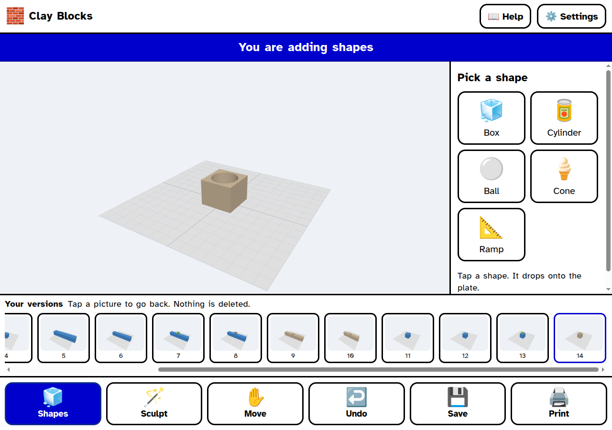

# Clay Blocks

Clay Blocks is a gentle 3D tool for 3D printing.

You stack simple shapes. Then you press **Make it clay** and sculpt.

It is made for people who find busy 3D tools hard to use. That includes autism, ADHD, dyslexia, memory problems, and brain injury.

You do not need an account. After you install the app, it works with the internet off.

This copy is for your own personal use. UnityForge Labs sells it. Please read [LICENCE.md](LICENCE.md).

## Run it in three steps

1. Open this folder.
2. Start the little server.
   - **Windows:** double-click **Start Clay Blocks**.
   - **Mac or Linux:** double-click **start.sh**, or open a terminal here and run `python3 serve.py`.
3. Open **http://127.0.0.1:8000** in **Chrome** or **Edge**.

You need Python 3 for that server. You do not need Node, and you do not run a build.

The longer guide is [INSTALL.md](INSTALL.md). It covers the offline install, every button, and how to save a file for your printer.

## What the print check really does

The print check looks at three things:

- Does the model fit the Bambu Lab X2D main space (256 by 256 by 260 mm)?
- Does it sit on the plate?
- After **Make it clay**, are there open edges in the skin?

**Fix it for me** only does two jobs. It makes the model smaller, or it sits the model on the plate.

**Make it clay** joins the solid shapes and cuts the holes. It does not close gaps in the skin.

A saved STL or 3MF file can still need a look in your printer app. The words on the print card say exactly what Clay Blocks checked.

## Credits

The 3D libraries and the reading font are made by other people. Their names and licences are in [CREDITS.md](CREDITS.md).
